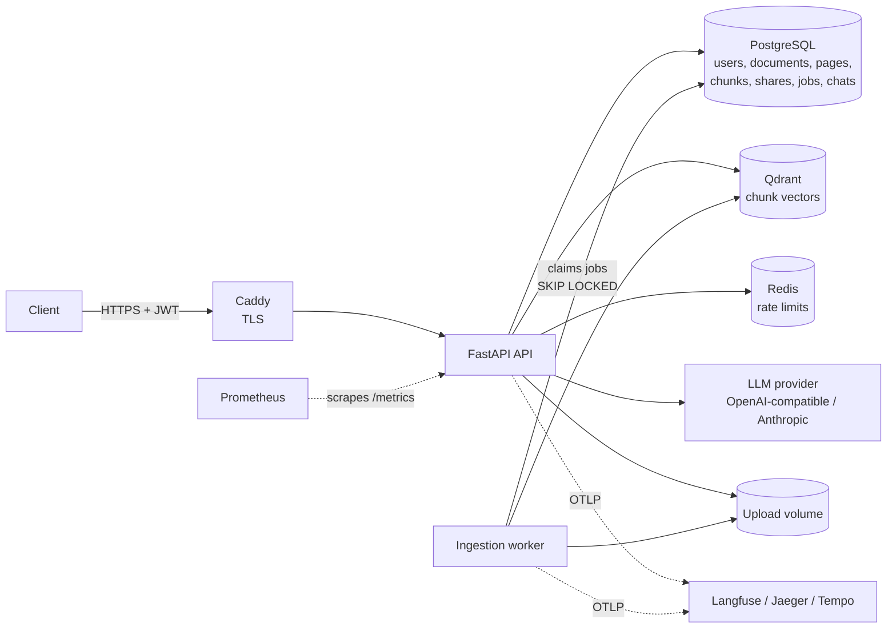

# Enterprise RAG Platform

Multi-user knowledge assistant over your PDFs. Upload documents, ask questions, and get answers
grounded in retrieved passages, with citations to the document, file name, page and supporting
sentence. When the documents don't contain the answer, it says so instead of guessing.

* PDF ingestion in the background: validation, page-level parsing, cleaning, chunking,
  embeddings, Qdrant indexing
* Retrieval: dense (Sentence Transformers), BM25, hybrid fusion (RRF or weighted),
  cross-encoder reranking, metadata and document filters
* Grounded answers with verified citations, prompt-injection containment, explicit refusals,
  conversations with history
* Users, JWT auth, document sharing with document-level authorization
* Rate limiting, structured logs, OpenTelemetry traces (Langfuse-compatible), Prometheus metrics
* A reproducible evaluation harness with measured results, and a CI regression gate

## Architecture



**Ask path:** authenticate → rate limit → resolve the documents this user may read (owned or
shared, ready, matching filters) → dense and BM25 retrieval in parallel, restricted to exactly
those documents → fusion → cross-encoder rerank → no evidence? refuse without calling the
model → prompt with numbered, escaped sources → LLM → keep only citations to sources it was
given; no valid citation? withhold the answer → respond with citations, tokens and latency.

**Ingest path:** streamed upload with size limit and SHA-256 → PDF signature check → per-user
dedupe → document and job rows in one transaction → worker parses pages (pypdf), cleans,
chunks, embeds, upserts to Qdrant, stores pages and chunks → `ready` or `failed` with a
readable reason.

Design decisions, data model, security model and assumptions:
[docs/architecture.md](docs/architecture.md). Deployment: [docs/deployment.md](docs/deployment.md).

```
src/rag_platform/
  api/            routes, schemas, dependencies, middleware (request id, body limit, headers)
  auth/           Argon2id passwords, JWT
  core/           settings, errors, logging, rate limiting
  db/             SQLAlchemy models and session
  repositories/   all SQL; access.py is the one definition of "readable"
  services/       auth, documents (upload/share), search, ask, conversations
  ingestion/      PDF parsing, cleaning, chunking, background worker
  embeddings/     Embedder protocol + Sentence Transformers
  retrieval/      dense, BM25, fusion, tokenizer
  reranking/      Reranker protocol + cross-encoder
  generation/     LLM providers, prompts, injection detection, citations
  evaluation/     datasets, metrics, LLM judge, runner
  observability/  tracing, metrics
migrations/       Alembic (0001-0004)
evaluation/       datasets and committed results
tests/unit, tests/integration
```

## Quick start

Requirements: Python 3.12+, [uv](https://docs.astral.sh/uv/), Docker with Compose v2.

```bash
cp .env.example .env    # set POSTGRES_PASSWORD (also inside DATABASE_URL), QDRANT_API_KEY, JWT_SECRET
docker compose up -d    # Postgres, Redis, Qdrant on 127.0.0.1
uv sync
uv run alembic upgrade head
uv run uvicorn --factory rag_platform.main:app_factory --reload
uv run python -m rag_platform.ingestion.worker   # second terminal
```

Generate secrets with `python -c "import secrets; print(secrets.token_urlsafe(48))"`. The
embedding model (~130 MB) and reranker (~90 MB) download on first start. Interactive API docs:
http://127.0.0.1:8000/docs (off in production).

Everything in Docker instead: `docker compose --profile app up -d --build` (runs migrations in a
one-shot container, then the API and worker).

To enable answers, point it at an LLM, for example any OpenAI-compatible endpoint:

```bash
LLM_PROVIDER=openai                  # or: anthropic
LLM_BASE_URL=https://api.openai.com/v1
LLM_API_KEY=...
LLM_MODEL=...
```

This also works with Groq, Google Gemini's OpenAI-compatible endpoint, vLLM, LiteLLM and
Ollama (`http://127.0.0.1:11434/v1`). Without an LLM, search works and `/ask` answers
`503 llm_not_configured`.

All settings are documented in [.env.example](.env.example).

A web front end (Next.js; sign in, upload, chat with citations) lives in [web/](web/README.md)
and deploys to Vercel; the API itself runs in Docker.

## API

| Method | Path | Who | Description |
|---|---|---|---|
| GET | `/health/live` | anyone | Process is up (no dependency checks) |
| GET | `/health/ready` | anyone | Postgres, Redis and Qdrant respond, else 503 |
| POST | `/auth/register` | anyone | Create an account (password 12-128 characters) |
| POST | `/auth/login` | anyone | Get a bearer token |
| GET | `/auth/me` | user | Current user |
| POST | `/documents` | user | Upload a PDF (multipart field `file`), 202 |
| GET | `/documents` | user | Readable documents (`ownership` = `all`, `owned`, `shared`) |
| GET | `/documents/{id}` | reader | Status, page count, latest ingestion job |
| GET | `/documents/{id}/pages` | reader | Cleaned text per page |
| DELETE | `/documents/{id}` | owner | Delete document, pages, chunks, vectors and file |
| GET / POST | `/documents/{id}/shares` | owner | List or grant read access (`{"email": ...}`) |
| DELETE | `/documents/{id}/shares/{user_id}` | owner | Revoke read access |
| POST | `/search` | user | Passages: `dense`, `sparse`, `hybrid`, `hybrid_rerank` (default) |
| POST | `/ask` | user | Grounded answer with citations, or a refusal |
| POST / GET | `/conversations` | user | Start or list conversations |
| GET / DELETE | `/conversations/{id}` | owner | A conversation with every stored turn |
| POST | `/conversations/{id}/messages` | owner | Ask in context of earlier turns |
| GET | `/metrics` | internal | Prometheus metrics (optional bearer token) |

A document you can't read answers 404, exactly like one that doesn't exist. A document shared
with you answers 403 to owner-only actions. Every error has the same shape, and every response
carries `X-Request-ID`:

```json
{"error": {"code": "not_found", "message": "Document not found", "request_id": "3f2a9c..."}}
```

### Example session

```bash
API=http://127.0.0.1:8000
curl -s -X POST $API/auth/register -H "Content-Type: application/json" \
  -d '{"email": "ana@example.com", "password": "a-long-enough-password"}'
TOKEN=$(curl -s -X POST $API/auth/login -H "Content-Type: application/json" \
  -d '{"email": "ana@example.com", "password": "a-long-enough-password"}' | jq -r .access_token)
curl -s -X POST $API/documents -H "Authorization: Bearer $TOKEN" -F "file=@annual-report.pdf"
```

```json
{
  "id": "7522735b-5394-4347-abe3-3841ac329368",
  "filename": "annual-report.pdf",
  "size_bytes": 1043,
  "content_sha256": "9c1f…",
  "page_count": null,
  "status": "pending",
  "error_message": null,
  "access": "owner",
  "created_at": "2026-10-31T11:18:58.990Z",
  "updated_at": "2026-10-31T11:18:58.990Z",
  "latest_job": {"id": "8838…", "status": "queued", "attempts": 0, "started_at": null, "finished_at": null}
}
```

Once the worker has processed it, `status` is `ready` (or `failed` with a reason such as
"No extractable text found. Scanned PDFs need OCR, which is not supported yet."). Upload errors:
`400 empty_file`, `409 duplicate_document` (with `details.document_id`), `413
payload_too_large`, `415 unsupported_media_type` (checked by file signature).

```bash
curl -s -X POST $API/search -H "Authorization: Bearer $TOKEN" -H "Content-Type: application/json" \
  -d '{"query": "How do PV modules turn light into power?", "mode": "hybrid_rerank", "top_k": 1,
       "filters": {"filename_contains": "energy"}}'
```

```json
{
  "mode": "hybrid_rerank",
  "latency_ms": 89.7,
  "results": [
    {
      "rank": 1,
      "score": -1.576,
      "chunk_id": "2b0c…",
      "document_id": "a41e…",
      "filename": "energy.pdf",
      "page_start": 1,
      "page_end": 1,
      "text": "Solar panels convert sunlight into electricity using photovoltaic cells.",
      "scores": {"dense": 0.764, "bm25": 1.458, "fused": 0.033, "rerank": -1.576}
    }
  ]
}
```

(Values from the Docker stack with the default models; the query shares no words with the
passage. `scores` shows each stage; `score` is the one the ranking uses. Filters also accept
`document_ids`, `uploaded_after` and `uploaded_before`, with time zones.)

```bash
curl -s -X POST $API/ask -H "Authorization: Bearer $TOKEN" -H "Content-Type: application/json" \
  -d '{"question": "What was revenue in Q3 2024?"}'
```

```json
{
  "answer": "Q3 2024 revenue was 4.2 million dollars [1].",
  "answered": true,
  "refusal_reason": null,
  "citations": [
    {
      "number": 1,
      "chunk_id": "…",
      "document_id": "7522…",
      "filename": "annual-report.pdf",
      "page_start": 2,
      "page_end": 2,
      "snippet": "The company reported quarterly revenue of 4.2 million dollars in Q3 2024."
    }
  ],
  "sources_considered": 3,
  "suspicious_sources": 0,
  "usage": {"model": "…", "prompt_tokens": 412, "completion_tokens": 14, "cost_usd": null},
  "latency": {"retrieval_ms": 85.2, "generation_ms": 910.4, "total_ms": 996.1}
}
```

(Shape as produced by the integration tests with a scripted model; token counts and latency
depend on your model.) When the documents don't answer the question: `"answered": false`, the
fixed answer `"I don't know based on the provided documents."`, no citations, and a
`refusal_reason` of `no_sources`, `low_relevance` (optional reranker-score threshold),
`model_declined`, or `unsupported` (the model answered without citing a source it was given,
so the answer is withheld).

Conversations: `POST /conversations` and then `POST /conversations/{id}/messages` with
`{"question": "And in 2023?"}`. The previous question is added to retrieval, and the last six
messages are sent to the model. Every stored answer keeps the citations and usage the user saw.

## Evaluation

```bash
uv run python -m rag_platform.evaluation.runner             # retrieval, all four modes
uv run python -m rag_platform.evaluation.runner --generate  # + answers (needs LLM_* settings)
```

The runner pushes the dataset through the real pipeline (PDF build, parsing, chunking,
embedding, Qdrant) in a throwaway database, collection and upload folder, runs every question,
and writes `evaluation/results/<dataset>-<timestamp>.{md,json}` with per-question rows.
Nothing is simulated; without an LLM the generation section reads "not measured".

**Dataset** (`evaluation/datasets/enterprise-v1`): 6 fictional documents (annual report,
datasheet, handbook, incident report, clinical trial summary, transit plan; 20 pages), 32
questions with reference answers and the exact file and page holding the evidence, and 6
questions the corpus can't answer. The facts are invented, so a model can't answer from
memory. Questions are tagged `lexical` (shares key terms or codes with the text) or
`paraphrase`. Bring your own with `--dataset path/to/dir` (same two files).

**Metrics.** Retrieval relevance is per page: a result counts if it is from an expected file
and covers an expected page. Recall@5, MRR, nDCG@5 (binary gains; repeats of a page count
once). Generation: answer rate on answerable questions, refusal rate on unanswerable ones,
citation precision and recall against the expected pages (deterministic), and LLM-as-judge
faithfulness (share of claims supported by the cited passages), relevancy and correctness
against the reference. Latency is wall-clock per question after an untimed warm-up; tokens
and cost come from the provider's usage report.

**Measured results** (2026-10-31, Windows laptop CPU, no GPU;
[evaluation/results/enterprise-v1-20261031T132037Z.md](evaluation/results/enterprise-v1-20261031T132037Z.md)):

| Mode | Recall@5 | MRR | nDCG@5 | Recall@5 lexical | Recall@5 paraphrase | Latency mean / p50 / p95 (ms) |
|---|---|---|---|---|---|---|
| dense | 1.000 | 0.924 | 0.944 | 1.000 | 1.000 | 53.6 / 51.9 / 63.0 |
| sparse (BM25) | 0.906 | 0.734 | 0.778 | 1.000 | 0.850 | 10.0 / 8.1 / 19.2 |
| hybrid (RRF) | 1.000 | 0.839 | 0.880 | 1.000 | 1.000 | 52.2 / 51.2 / 60.0 |
| hybrid + rerank | 1.000 | 0.943 | 0.957 | 1.000 | 1.000 | 228.6 / 218.7 / 278.5 |

* BM25 is fastest and perfect on lexical questions but misses 15% of paraphrased ones.
* RRF recovers BM25's misses but ranks the right page lower than dense alone (MRR 0.839 vs
  0.924): BM25 promotes keyword matches from the wrong page.
* The cross-encoder fixes the ordering (best MRR and nDCG) at about 4x the latency.
* The corpus is small, so Recall@5 saturates for three modes; MRR and nDCG separate them. A
  larger corpus with near-duplicate documents is needed to compare recall. Treat these numbers
  as a regression baseline, not a general claim about the methods.

**Generation** (2026-11-01, `openai/gpt-oss-120b` on Groq's free tier, retrieval
`hybrid_rerank`, all 38 questions; the judge is the same model;
[evaluation/results/enterprise-v1-20261101T051941Z.md](evaluation/results/enterprise-v1-20261101T051941Z.md)):

| Metric | Value |
|---|---|
| Answered (32 answerable questions) | 1.000 |
| Refused (6 unanswerable questions) | 1.000 |
| Citation precision / recall (deterministic, vs expected pages) | 1.000 / 1.000 |
| Faithfulness (judge) | 0.911 |
| Relevancy (judge) | 1.000 |
| Correctness vs reference (judge) | 0.891 |
| End-to-end latency mean / p50 / p95 | 6.0 s / 6.8 s / 9.7 s |
| Avg prompt / completion tokens | 844 / 102 |
| Cost | not reported (free tier; set `LLM_PRICE_*` for paid models) |

* Every answerable question was answered with a citation to the right page, and every
  unanswerable one got the fixed refusal: no hallucinated answers on this set.
* The judge scores are noisier than the deterministic ones. Most correctness half-points are
  answers that leave out a secondary detail of the reference ("plus public holidays"), and the
  lowest faithfulness score (0.0 on `tr-01`) is a judge error: the answer quotes the cited
  passage. Use a different, stronger judge model for decisions that depend on these numbers.
* Latency includes waiting out the free tier's rate limits (the client retries 429s), so it
  overstates what a paid endpoint would show.
* The first run of this evaluation found a real bug: this model cites as `【2】`, not `[2]`, so
  valid answers were withheld as uncited. The parser now accepts both (and lists like `[1, 3]`).

`tests/integration/test_retrieval_benchmark.py` repeats the retrieval evaluation in CI and fails
when a mode drops below a floor set just under these numbers.

## Testing

```bash
uv run ruff check . && uv run ruff format --check . && uv run mypy
uv run pytest                  # unit tests (no services)
uv run pytest -m integration   # needs `docker compose up -d`; real models, Postgres, Qdrant, Redis
```

Unit tests cover parsing (empty, malformed, truncated, encrypted, scanned PDFs), cleaning,
chunking, BM25, fusion, metrics, prompt construction and escaping, injection detection,
citation parsing, the ask pipeline with a scripted LLM, provider wire formats, auth primitives,
rate limiting, metrics and tracing. Integration tests run against real services: migrations
(upgrade equals models, clean downgrade), upload and ingestion end to end, duplicates,
cross-user access on every read path, sharing and revocation, search and ask isolation,
conversations, the real embedding and reranker models, Redis rate limiting, and the retrieval
regression benchmark.

## Observability

* **Logs**: JSON lines with `request_id`, plus `trace_id`/`span_id` inside traced work.
  Questions, answers and document text are not logged.
* **Traces** (OpenTelemetry): HTTP requests and spans for `search`, `retrieve.dense`,
  `retrieve.bm25`, `rerank`, `llm.generate` (`gen_ai.*` model and token attributes) and
  `ingest.document`. Set `OTEL_EXPORTER_OTLP_ENDPOINT` to export. Langfuse ingests OTLP
  directly: endpoint `https://cloud.langfuse.com/api/public/otel` and
  `OTEL_EXPORTER_OTLP_HEADERS=Authorization=Basic <base64 of public:secret key>`. Span
  attributes hold ids, counts and timings, never user content.
* **Metrics** at `/metrics`: request rate and latency per route template, search latency per
  mode, LLM tokens, latency and cost per model, answer outcomes, suspicious sources, rate-limit
  rejections.

## Security

* Secrets only from the environment; startup fails on a missing or short `JWT_SECRET`.
  Argon2id passwords; JWTs pinned to one algorithm and audience.
* Document-level authorization in one module (`repositories/access.py`), used by every read
  path; search is restricted to a document set resolved in Postgres before Qdrant or BM25 run.
* Uploads: streamed size limit (declared and actual bytes), PDF signature check, generated
  storage names, page limit, per-user upload rate limit.
* Prompt injection: document text is escaped data in the user message, never instructions;
  suspicious passages are flagged; uncited answers are withheld.
* Rate limits in Redis (login and registration per IP, search, ask and upload per user), `429`
  with `Retry-After`.
* Safe errors (no stack traces, no echoed input), CSP and other security headers, HSTS in
  production, datastores never exposed publicly.

## Limitations

* **No OCR**: scanned PDFs without a text layer fail with a clear message. Tables and
  multi-column layouts are extracted as plain text in pypdf's reading order.
* **English-first**: the default embedding model, reranker and BM25 tokenizer (English
  stopwords, no stemming) are tuned for English. Multilingual models are a configuration change
  but haven't been evaluated here.
* **BM25 in memory**: one index per user per API process, rebuilt when that user's corpus
  changes. Fine for hundreds of PDFs per user; very large corpora need a dedicated sparse index.
* **Parsing is not sandboxed**: a pathological PDF can occupy a worker thread for a long time
  (there is a page limit, but no hard timeout).
* **Evaluation**: a small synthetic dataset (saturates Recall@5), measured with one model. The
  LLM judge is by default the answering model itself, which can be lenient or noisy.
* **Sharing** is per user and read-only; there are no groups, roles or admin read access.
* **Local file storage** for uploads (one volume); multiple hosts would need object storage.
