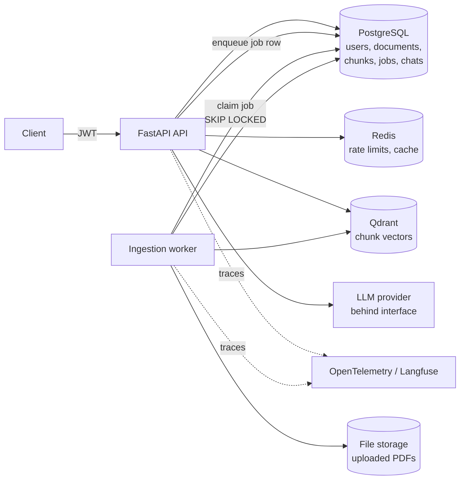

# Architecture

This document is the design proposal for the platform. Sections marked *(planned)* describe
later milestones; everything else exists in the code today.

## 1. Requirements recap

* Multi-user assistant over 100+ PDFs. Answers must be grounded in retrieved passages and cite
  document id, filename, page number and snippet. When the evidence is insufficient the system
  says so instead of guessing.
* Hybrid retrieval (dense + BM25), configurable fusion, cross-encoder reranking, metadata and
  document filters.
* Per-user isolation: a user can never retrieve, cite or even learn the existence of another
  user's document.
* Measurable quality: reproducible evaluation set, retrieval and answer metrics, real numbers only.

## 2. System overview



**Query path** *(planned)*: authenticate → rate-limit → resolve the caller's accessible document
ids → dense search (Qdrant, filtered by `owner_id`/`document_id` payload) and BM25 search
(filtered the same way) in parallel → fusion (RRF by default, weighted-score optional) →
cross-encoder rerank top-N → evidence sufficiency check → grounded generation with numbered
sources → citation validation → persist turn → respond.

**Ingestion path**: upload streamed to a temp file while the size limit and SHA-256 are
computed → PDF signature check → per-owner dedupe → `documents` row (`pending`) and
`ingestion_jobs` row in one transaction → file moved into place → commit. The worker claims the
job, parses page by page in a thread, cleans the text and stores one `document_pages` row per
page, then chunks the pages, embeds the chunks and upserts them to Qdrant before storing the
`chunks` rows → `ready`, or `failed` with a message safe to show the owner. Re-running a job
replaces pages, chunks and vectors instead of duplicating them.

## 3. Code layout

```
src/rag_platform/
  main.py              app factory, lifespan, middleware wiring
  container.py         composition root: builds clients once, exposes them via DI
  core/                config, logging, error types and handlers
  api/                 HTTP only: routes, request/response schemas, dependencies, middleware
  db/                  SQLAlchemy base, session factory, ORM models
  infrastructure/      clients and probes for Postgres, Redis, Qdrant
  # added in later milestones, one package per concern:
  auth/                Argon2id password hashing, JWT access tokens
  repositories/        all SQL lives here; document queries take the owner's id
  services/            use-case orchestration (auth, documents; later ask, chats)
  ingestion/           PDF validation + parsing, text cleaning, chunking, worker
  embeddings/          Embedder protocol + Sentence Transformers implementation
  retrieval/           dense (Qdrant) and BM25 retrievers, tokenizer, RRF / weighted fusion
  reranking/           Reranker protocol + cross-encoder implementation
  generation/          LLM provider protocol (OpenAI-compatible, Anthropic), prompts,
                       prompt-injection detection, citation parsing and verification
  evaluation/          datasets, metrics, experiment runner                   (M8)
migrations/            Alembic, async env reading DATABASE_URL
tests/unit|integration
```

Dependency rule: `api → services → repositories/retrieval/generation → infrastructure`. Routes
never touch SQL or clients directly; services never import FastAPI.

## 4. Key design decisions

| Decision | Choice | Why |
|---|---|---|
| Dependency injection | One `Container` built in the lifespan, exposed with `Depends` | Explicit, no DI framework, tests swap parts (e.g. health probes) without monkeypatching. |
| Config | `pydantic-settings`, secrets as `SecretStr`, no defaults for secrets | Startup fails fast on missing/weak secrets; secrets never appear in `repr` or logs. |
| Errors | One JSON envelope `{error: {code, message, request_id}}` | Clients get a stable contract; internals (SQL, hosts, stack traces) are only logged. Validation errors report location, never the submitted value. |
| Request tracing | Pure-ASGI middleware sets/propagates `X-Request-ID`, binds it to every log line | Works with streaming responses; caller-supplied ids are accepted only if they match `[A-Za-z0-9._-]{1,128}`. |
| Health | `/health/live` (no dependencies) and `/health/ready` (all dependencies, per-probe timeout, 503 on failure) | Orchestrators don't restart healthy processes during a database blip; readiness exposes only the error type. |
| Database | Async SQLAlchemy 2 + asyncpg, Alembic with deterministic constraint names | Typed models, async I/O, stable autogenerate diffs. A test asserts migrations equal the models. |
| Job queue | PostgreSQL table claimed with `FOR UPDATE SKIP LOCKED`, lease + bounded retries | The job is created in the same transaction as the document, so no upload can lose its job (a Redis queue can't give that). One fewer moving part than arq/Celery; throughput needs are small. |
| Upload size | Pure-ASGI body limit (declared and streamed bytes) plus a check while staging | Starlette spools multipart files of any size to disk; the limit stops a request before that. |
| Auth timing | Brought forward from M7: register/login/JWT and the current-user dependency | Uploads need an owner, and a fake "user id header" would be a security hole to remove later. M7 adds conversations and the remaining authorization tests. |
| Chunking | Sentence-aligned greedy packing by word count (default 300 words, 50 overlap), one page per chunk by default | Word counts keep chunking independent of the embedding model and deterministic. Single-page chunks make every citation point at exactly one page; `CHUNK_CROSS_PAGES=true` trades that for context across page breaks. |
| Embeddings | `BAAI/bge-small-en-v1.5`, normalised vectors, cosine distance, query instruction prefix | Small enough for CPU, strong on retrieval benchmarks for its size. Behind an `Embedder` protocol, so a hosted model is a drop-in. |
| Vector store layout | One collection, payload `owner_id`/`document_id` with keyword indexes; point id = chunk id | One filter restricts any search to a user's documents; the chunk row in Postgres is the source of truth for text and citations. A collection built for another vector size is refused at startup. |
| PyTorch | CPU-only wheels from the PyTorch index via `tool.uv.sources` | The default Linux wheel ships CUDA (~2.5 GB) that the image doesn't use. |
| Sparse retrieval | Own Okapi BM25 (k1=1.5, b=0.75), one in-memory index per user, cached per process and rebuilt when a fingerprint (ready documents, chunk count, last update) changes | Exact BM25 with per-user term statistics: other users' documents never influence scores. Qdrant's sparse vectors would compute IDF across all users. Cost: memory and a rebuild per corpus change, fine for hundreds of PDFs per user; see limitations. |
| Search results | Retrievers return ids and scores only; text, page and filename are loaded from Postgres scoped to the owner and to `ready` documents | A stale vector (e.g. a failed delete) can't surface: it has no live row. |
| Model warm-up | API loads the embedding model in the background at startup | The first search otherwise took ~12 s on CPU. |
| Hybrid fusion | RRF (k=60) by default, weighted min-max fusion as an option; each retriever contributes 30 candidates | RRF needs no score calibration between BM25 and cosine. M8 measures whether weighted fusion is better on our data. |
| Reranking | `cross-encoder/ms-marco-MiniLM-L-6-v2` over the top 20 fused candidates; default search mode | Cross-encoders read query and passage together and fix ordering mistakes of both retrievers. 20 candidates keeps CPU latency bounded; configurable. |
| Metadata filters | Filename substring and upload-date range, resolved in Postgres to a set of document ids before retrieval | One mechanism for all filters: both retrievers already accept a document set, and the owner condition is never optional. |
| Grounding | Sources numbered and escaped inside `<source>` elements of the user message; the system prompt holds the only instructions, including a fixed refusal sentence | Document text can't close its element or pose as instructions; the refusal is detected by string match, not by interpreting the model. |
| Citation checks | `[n]` markers are kept only if `n` was provided; an answer with no valid citation is withheld and replaced by the refusal (`ASK_REQUIRE_CITATIONS`) | The model cannot cite unseen documents, and uncited claims never reach the user. Snippets are the source sentence that best matches the citing sentence. |
| Prompt injection | Structural isolation plus a regex detector that marks suspicious sources in the prompt and counts them in the response | Detection alone is bypassable; isolation alone gives no signal. Together they make attempts visible without dropping legitimate documents. |
| Orchestration | A plain async pipeline (retrieve → check → generate → verify), not LangGraph | The flow is linear with two early exits. A graph framework would add a dependency and indirection without adding capability; it becomes worthwhile if multi-step agentic retrieval is added. |
| Sharing | Read-only grants by owner, one row per (document, user); BM25 indexes are per user over all readable documents, with a fingerprint that hashes the exact document id set | Covers team use without roles or groups. The digest makes the cache invalidate on any share change, not just on uploads. |
| Conversations | Turns stored with the citations and usage the user saw; the last 6 messages are sent as context; retrieval uses the previous question plus the current one | Follow-ups ("and in 2023?") need context both for retrieval and for the model. Old `[n]` markers are stripped from history so they can't be confused with the new sources. A failed turn stores nothing. |
| Duplicate uploads | `UNIQUE(owner_id, content_sha256)` on `documents` | Duplicate detection is enforced by the database, per user, so users don't learn about each other's files. |
| Dependency management | `uv` with committed `uv.lock` | Reproducible installs locally, in CI and in Docker (`--frozen`). |
| Containers | Multi-stage image, non-root user, datastore ports bound to `127.0.0.1` | Small attack surface by default. |

## 5. Data model (current migration)

* `users`: id (uuid), email (unique), hashed_password, is_active, is_admin, timestamps.
* `documents`: id, owner_id → users (cascade), filename, content_sha256, size_bytes, mime_type,
  storage_path, page_count, status (`pending|processing|ready|failed`), error_message, timestamps.
* `ingestion_jobs`: id, document_id → documents (cascade), status
  (`queued|running|succeeded|failed`), attempts, error_message, started_at, finished_at, timestamps.
  Index on (status, created_at) for claiming.
* `document_pages`: (document_id, page_number) primary key, cleaned text, char_count. Blank
  pages are kept so page numbers always match the PDF.

* `chunks`: id (= Qdrant point id), document_id, owner_id (denormalised for filtering),
  ordinal (unique per document), page_start, page_end, text, word_count. Source for BM25 and
  citation snippets.

* `document_shares`: (document_id, user_id) primary key, created_at. Cascade on either side.
* `conversations`: id, owner_id, title, timestamps. `messages`: id, conversation_id, role,
  content, answered, refusal_reason, citations (JSONB), usage (JSONB), timestamps.

## 6. Security model

* **Authorization lives in the data access layer.** `repositories/access.py` is the only
  definition of "readable" (owned, or shared via `document_shares`). Every document, page,
  chunk and search query is built from it. Search resolves the readable, ready document ids in
  Postgres first; Qdrant and BM25 are then restricted to exactly that set, so there is no
  "unfiltered search" to call by mistake, and a revoked share stops matching immediately.
* **404 vs 403.** A document you can't read answers 404 (its existence is not revealed). A
  document you can read but don't own answers 403 to owner-only actions (delete, share).
* **Prompt injection.** Retrieved text is placed in a delimited, clearly labelled data section of
  the user turn, never in the system prompt; the system prompt instructs the model to treat it as
  untrusted quotes. Answers are post-checked: every citation must refer to a passage that was
  actually supplied, otherwise it is dropped (and the answer refused if nothing remains).
* **Uploads.** Size limit enforced while streaming, PDF magic bytes checked, files stored under
  generated names (never the user-supplied filename), parsing done in the worker with time limits.
* **Rate limiting** with Redis (fixed window per user + per IP for auth endpoints).
* **No secrets in code or images.** `.env` is git- and docker-ignored; `.env.example` holds only
  placeholders.

## 7. Assumptions (please correct any that are wrong)

Known limitations so far: there is no OCR, so scanned PDFs without a text layer fail with a
clear message. Parsing runs in a thread with a page limit, but a pathological PDF can still
occupy a worker for a long time because a Python thread cannot be killed; a process pool with
hard timeouts is the fix if this shows up in practice. BM25 indexes live in each API process's
memory: very large per-user corpora (hundreds of thousands of chunks) would need a dedicated
sparse index (e.g. OpenSearch or Qdrant sparse vectors) instead. The tokenizer is English-only
(stopwords, no stemming).


1. **Ownership model:** documents are private to the uploader unless the owner shares read access
   with specific users. There are no groups or admin read-all access.
2. **Auth:** built-in email/password with JWT access tokens (no external IdP for now).
3. **LLM provider:** abstracted behind an interface. The default implementation will target an
   OpenAI-compatible HTTP API (works with OpenAI, vLLM, Ollama, LiteLLM, etc.) plus a
   deterministic fake for tests. A real API key is needed to measure answer-quality metrics.
4. **Embeddings / reranker defaults:** `BAAI/bge-small-en-v1.5` (384-d) and
   `cross-encoder/ms-marco-MiniLM-L-6-v2`, chosen to run on CPU; both configurable.
5. **Background jobs:** a worker process polling a PostgreSQL job table (see section 4).
6. **File storage:** local volume for now behind a small storage interface (S3 later).
7. **Language:** English-first models; multilingual models (e.g. for Indonesian documents) are a
   config change, evaluated separately.
8. **Evaluation corpus:** a reproducible set built from openly licensed PDFs downloaded by a
   script with pinned URLs and checksums, plus hand-written Q/A pairs with expected pages.

## 8. Milestones

1. Project setup and infrastructure (done)
2. PDF ingestion and parsing (done)
3. Chunking, embeddings and Qdrant indexing (done)
4. Dense and BM25 retrieval (done)
5. Hybrid search and reranking (done)
6. Grounded LLM generation and citations (done)
7. Conversation history and multi-user authorization (done)
8. Evaluation and benchmarking
9. Observability, security and performance
10. Docker deployment, CI/CD and documentation
